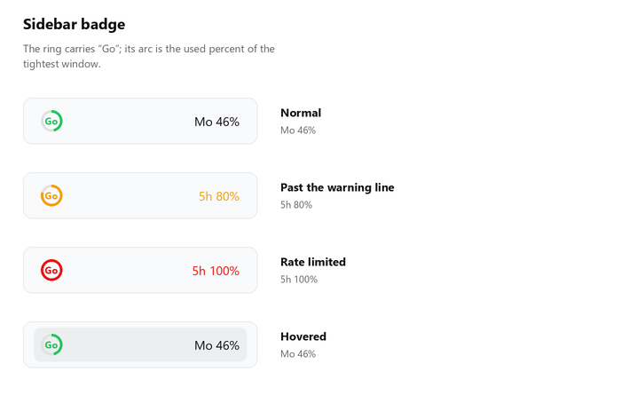
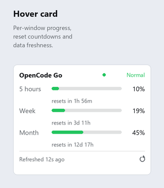

# dsh-opencode-go-quota

[](LICENSE)
[](https://github.com/deepseek-ai/deepseek-harness)
[](CHANGELOG.md)

English | [中文](README.md)

A **DeepSeek Harness plugin** that shows [OpenCode Go](https://opencode.ai/docs/go/) quota usage directly in the sidebar.

One glance at the small ring in the sidebar footer shows the usage and reset time of all three windows — no need to open the console page.

---

## Screenshots

**Sidebar badge**



**Hover card**



---

## Features

- **"Go" inside the ring** — the ring carries both the progress arc and the brand mark, costing no extra horizontal space
- **Reports the tightest window** — the three windows have independent caps; the badge shows whichever is closest to its limit
- **Failures never discard data** — an unavailable upstream keeps the last good reading and marks it stale
- **Credential reuse** — reads the API key already configured in your model settings; nothing to enter twice
- **Bilingual** — Chinese and English dictionaries that follow the DSH language setting live
- **Backoff on failure** — consecutive failures widen the polling interval exponentially

---

## Quota model

OpenCode Go quota consists of three **sibling** windows. Exhausting any one of them triggers rate limiting:

| Window | Upstream field | Allowance | Reset rule |
|---|---|---|---|
| 5 hours | `rolling` | 20% of the monthly allowance | Sliding: last usage time + 5 hours |
| Week | `weekly` | 50% of the monthly allowance | Calendar week boundary |
| Month | `monthly` | 100% of the monthly allowance | Billing month anchored to your subscribe date |

The plugin always shows **the window closest to its limit**. Because the three are siblings, showing only the monthly window would give an overly optimistic signal as the 5-hour window approaches its cap.

---

## Install

### Prerequisites

- DeepSeek Harness (desktop app or `dsh web`)
- An OpenCode Go / Go Plus subscription with the API key already configured in DSH's model settings

The plugin reads the same credential reference your `llm-pi-ai` provider uses, so there is nothing to enter twice:

```yaml
- id: llm-pi-ai
  name: "@deepseek-ai/dsh-llm-pi-ai"
  config:
    providers:
      opencode-go:
        apiKeyEnv: OPENCODE_GO_API_KEY
```

### Steps

Place the repository anywhere, then:

```bash
dsh plugin --profile desktop add /absolute/path/to/dsh-opencode-go-quota
```

You can also install the local path from the **Plugins** page in the DSH GUI.

**Restart DSH afterwards** — client bundles are folded into the boot graph server-side at startup.

---

## Configuration

All options live under the `config` key of `cordis.patch.yml`:

| Key | Default | Description |
|---|---|---|
| `apiKeyRef` | `OPENCODE_GO_API_KEY` | Credential reference; keep it aligned with your model settings |
| `baseUrl` | `https://opencode.ai` | Upstream base URL |
| `pollIntervalSec` | `300` | Upstream poll interval in seconds (floor 30) |
| `maxBackoffSec` | `1800` | Backoff ceiling after consecutive failures |
| `warnPercent` | `80` | Warning threshold; the ring turns amber at or above it |
| `criticalPercent` | `95` | Critical threshold; the ring turns red at or above it |

---

## Interface

### Sidebar badge

```
(Go) ................ Mo 46%
 ↑                     ↑
 ring: progress+brand  used percent of the tightest window
```

- **Arc length** is the used percent of the tightest window
- **Colour** follows the thresholds: green below 80%, amber from 80%, red from 95%
- **Window tag** names the tightest window (`5h` / `Wk` / `Mo` in English, `5h` / `周` / `月` in Chinese)
- When the sidebar is collapsed only the ring remains; the "Go" inside keeps it recognisable
- Hovering shows a row background, matching the sidebar's other entries

### Hover card

Hover to expand. It shows a progress bar per window, the reset countdown, and how fresh the data is.

- A 260 ms grace period on mouse-out lets the pointer travel into the card
- Clicking the badge, or pressing anywhere inside the card, pins it — after that you can select text and click refresh freely
- `Esc`, clicking outside, or clicking the badge again closes it

Status shown at the top right:

| Status | Meaning |
|---|---|
| Normal | Last fetch succeeded, no window is rate limited |
| Rate limited | Some window reports `status === 'rate-limited'` |
| Stale | Fetch failed; the last successful reading is shown |
| Unavailable | Fetch failed and no data is available |

---

## How it works

```
┌─ Client half (lib/client.js) ────────────────────────────┐
│  sidebar.footer.action slot → badge + hover card         │
│  Reads the host's in-memory snapshot every 30 s          │
└───────────────────────▲──────────────────────────────────┘
                        │ same-origin fetch (over IPC on desktop)
┌───────────────────────┴──────────────────────────────────┐
│  Host half (lib/index.js)                                │
│   ├ ctx.credentials.resolve(apiKeyRef)                   │
│   ├ self-scheduling poll of zen/go/v1/usage, with backoff
│   └ ctx.webServer route GET /opencode-go-quota/state     │
└───────────────────────▲──────────────────────────────────┘
                        │ HTTPS
                  opencode.ai
```

### Implementation notes

**The host half imports nothing from `@deepseek-ai/*`.**
The plugin is installed under the profile directory, where DSH's internal packages do not resolve. `CredentialRef` and service keys are plain strings at runtime — their branding exists only at the type level — so passing `'OPENCODE_GO_API_KEY'` directly is sufficient.

**Data travels over a same-origin HTTP route rather than a Remote namespace.**
`dsh-api-remotes`' client namespace set is a fixed build-time import list that plugins cannot extend (see `dsh-api-remotes/README.md:75-76`). The plugin therefore registers an exact route with `ctx.webServer.register()` and calls `ctx.connection.admit(req)` inside the handler, reusing the application's own request-trust policy instead of implementing its own auth.

### Data source

```
GET https://opencode.ai/zen/go/v1/usage
Authorization: Bearer <OPENCODE_GO_API_KEY>
```

```json
{
  "usage": {
    "rolling": { "status": "ok", "percent": 18, "resetsAt": "2026-10-08T08:42:48.000Z" },
    "weekly":  { "status": "ok", "percent": 41, "resetsAt": "2026-10-11T00:00:00.000Z" },
    "monthly": { "status": "ok", "percent": 68, "resetsAt": "2026-10-20T03:42:48.000Z" }
  }
}
```

| HTTP | type | Meaning |
|---|---|---|
| 401 | `AuthError` | Key missing or invalid |
| 403 | `EntitlementError` | This account has no OpenCode Go subscription |

---

## Development

### Tests

Two offline test suites ship with the project — **no DSH instance required**:

```bash
pnpm install     # installs react / react-dom for the render test
pnpm test
```

**`test/client.test.mjs`** — render test.
Provides a mock `window.__ModuleLoader__` facade, evaluates the bundle, and runs the factory with a `require` that only knows `react`. Component state is injected by replacing `React.useState` with a queue (SSR never runs effects). Covers six badge states, four card states, both languages, and the `createPortal` fallback branch.

**`test/host.test.mjs`** — host logic test.
Builds a minimal Cordis context, runs `apply()`, then reads the snapshot back through the route the plugin registered itself. Covers the happy path, an unreachable upstream, and the case where a failure must retain existing data.

The host test needs a real credential, resolved in this order:

1. the `OPENCODE_GO_API_KEY` environment variable
2. `OPENCODE_GO_API_KEY` inside `~/.dsh/.credentials.yaml`

If neither exists, the networked cases are skipped automatically.

### Modifying the code

Plain JavaScript, **no build step**.
The client half is a hand-written ModuleLoader bundle (`window.__ModuleLoader__.load({...})`) whose factory only `require`s `react`; everything else is inlined.

Editing `lib/client.js` requires a **DSH restart**.

---

## FAQ

**The badge shows month 46% — why not the 5-hour number?**
The badge shows whichever window is currently closest to its limit. Once the 5-hour window's percentage exceeds the monthly one, the tag switches to `5h` automatically.

**Why is there no "today's usage"?**
The upstream has no daily window. Deriving one locally would require accumulating poll deltas, and only while DSH runs — incomplete data, so it is not implemented.

**Can I see a per-model breakdown?**
No. The console page offers one, but it is served through a login session rather than the API key, so a plugin cannot reach it. This plugin reports the three aggregate percentages.

**How often does the data update?**
The host polls upstream every 5 minutes (adjustable via `pollIntervalSec`), and the client reads the local snapshot every 30 seconds. Hovering the card re-reads once, and the refresh button at the card's bottom right fetches upstream immediately.

**It says "Credential OPENCODE_GO_API_KEY is not configured"?**
DSH's credential service has no such name. Check that the opencode-go provider key is configured in your model settings.

---

## Known limitations

- The upstream endpoint is an internal console route, not a promised public API. Hence the configurable `baseUrl` and the degraded display (rather than a crash) when parsing fails.
- `percent` is an integer (the server applies `Math.floor`), so the granularity is coarse.
- Only Chinese and English dictionaries ship. A locale fallback chain must terminate at `en`, so other languages fall back to English.
- The host's raw error text is written in Chinese and is only shown as a fallback for unknown state codes.

---

## License

[MIT](LICENSE)
