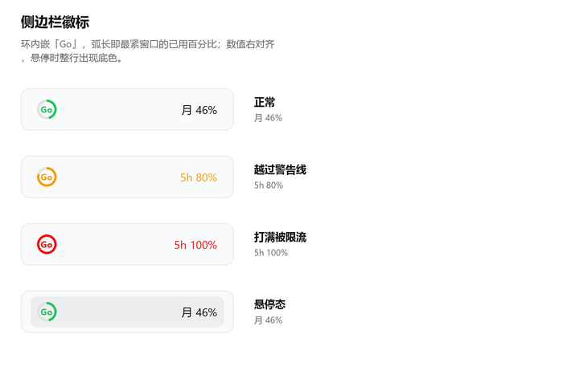
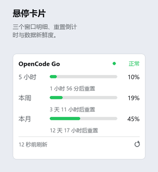

# dsh-opencode-go-quota

[](LICENSE)
[](https://github.com/deepseek-ai/deepseek-harness)
[](CHANGELOG.md)

[English](README.en.md) | 中文

**DeepSeek Harness 插件**：在侧边栏实时显示 [OpenCode Go](https://opencode.ai/docs/go/) 的额度消耗。

鼠标划过侧边栏页脚那枚小环，就能看到三个窗口的用量与重置时间，无需另开控制台页面。

---

## 截图

**侧边栏徽标**



**悬停卡片**



---

## 特性

- **环内嵌品牌字** —— 环同时承担进度指示与品牌标识（`Go` / `DS`），不占用额外横向空间
- **只报最紧的窗口** —— 同一家有多个窗口时，显示最接近触顶的那个
- **窗口数量由上游决定** —— 不写死「三个窗口」，按套餐给窗口的来源也能正确展示
- **失败不丢数据** —— 上游不可用时保留上一次成功的数据并标记为过期
- **凭证复用** —— 直接读取模型设置里已配置的 API key，无需另填一份
- **中英双语** —— 跟随 DSH 的语言设置即时切换
- **失败退避** —— 连续失败时按指数放大轮询间隔
- **故障隔离** —— 每个额度源各自一个调度器，一家挂了不影响别家的节奏与数据

---

## 额度源

插件内置两个适配器，各自独立取数、独立退避：

| ID | 名称 | 凭证来源 | 额度形态 |
|---|---|---|---|
| `opencode-go` | OpenCode Go | DSH 凭证 `OPENCODE_GO_API_KEY`（与模型设置共用） | 5 小时 / 周 / 月三个百分比窗口 |
| `deepseek` | DeepSeek | DSH 凭证 `DEEPSEEK_API_KEY` | 账户余额（无窗口） |

删掉 `providers:` 下某一行即关掉那一家；写 `enabled: false` 可临时停用而保留配置。

### OpenCode Go

额度由三个**平级**窗口组成，任一打满即触发限流：

| 窗口 | 上游字段 | 额度 | 重置规则 |
|---|---|---|---|
| 5 小时 | `rolling` | 月度额度的 20% | 滚动窗口：最后一次用量时间 + 5 小时 |
| 周 | `weekly` | 月度额度的 50% | 自然周边界 |
| 月 | `monthly` | 月度额度的 100% | 订阅日锚定的账单月 |

插件始终显示**最接近上限的那个窗口**。由于三者平级，仅显示月度窗口会在 5 小时窗口接近打满时给出过于乐观的信号。

---

## 安装

### 前置条件

- DeepSeek Harness（桌面版或 `dsh web`）
- 已订阅 OpenCode Go / Go Plus，且 API key 已配置到 DSH 的模型设置中

插件读取的是 `llm-pi-ai` provider 使用的同一个凭证引用，无需重复填写：

```yaml
- id: llm-pi-ai
  name: "@deepseek-ai/dsh-llm-pi-ai"
  config:
    providers:
      opencode-go:
        apiKeyEnv: OPENCODE_GO_API_KEY
```

### 安装步骤

将仓库放在任意位置，然后：

```bash
dsh plugin --profile desktop add /绝对路径/dsh-opencode-go-quota
```

也可以在 DSH 图形界面的 **Plugins** 页面中安装本地路径。

安装后需**重启 DSH**——客户端 bundle 在启动时由服务端合成加载图。

---

## 配置

配置项位于 `cordis.patch.yml` 的 `config` 段。

**全局**（对每个额度源生效，可被 provider 级同名字段覆盖）：

| 键 | 默认值 | 说明 |
|---|---|---|
| `pollIntervalSec` | `300` | 上游轮询间隔（秒），下限 30 |
| `maxBackoffSec` | `1800` | 连续失败时的退避上限（秒） |
| `warnPercent` | `80` | 警告阈值，达到后转为琥珀色 |
| `criticalPercent` | `95` | 危急阈值，达到后转为红色 |

**`providers.<id>`** —— 每个额度源一行，`enabled: false` 可停用：

| 键 | 适用于 | 说明 |
|---|---|---|
| `enabled` | 全部 | `false` 停用该额度源 |
| `apiKeyRef` | opencode-go / deepseek | 凭证引用名，与模型设置保持一致 |
| `baseUrl` | 全部 | 上游基址 |

```yaml
providers:
  opencode-go:
    apiKeyRef: OPENCODE_GO_API_KEY
  deepseek:
    apiKeyRef: DEEPSEEK_API_KEY
```

---

## 界面

### 侧边栏徽标

```
(Go) ................ 月 46%
 ↑                     ↑
 环：进度 + 品牌        最紧窗口的已用百分比
```

- **弧长**为最紧窗口的已用百分比
- **配色**随阈值变化：低于 80% 为绿色，80% 起为琥珀色，95% 起为红色
- **窗口标识**为当前最紧的窗口（中文 `5h` / `周` / `月`）
- **百分比**整数不带小数点，有小数才保留一位（`6.5%`）
- 侧边栏折叠时仅显示环，环内的品牌字保证它仍可辨识
- 悬停时整行显示底色，与侧边栏其他条目一致
- 行高、内边距、圆角与下方账号行取同一组数字，环与账号头像左对齐

### 多额度源

每家一页，左右滑动切换；徽标只报当前页那一家的最紧窗口，不做跨家聚合——
两家各自的额度是两笔独立预算，合并成一个数字会让人误以为是同一份额度。
页码圆点按各自状态着色，所以停在 A 页时 B 页变红也一眼看得见。

### 悬停卡片

鼠标划过展开，显示各窗口的进度条、重置倒计时与数据新鲜度。

- 移出后留有 260 毫秒宽限期，便于指针移入卡片
- 点击徽标或在卡片内按下会固定卡片，之后可自由选中文字、点击刷新
- `Esc`、点击外部或再次点击徽标均可关闭
- 滚动窗口（`activity_triggered`）没有确定重置时刻时显示「按使用滚动重置」

卡片右上角显示数据状态：

| 状态 | 含义 |
|---|---|
| 正常 | 最近一次拉取成功，无窗口被限流 |
| 已限流 | 有窗口报告 `status === 'rate-limited'` |
| 数据过期 | 拉取失败，展示的是上一次成功的数据 |
| 不可用 | 拉取失败且无可用数据 |

---

## 工作原理

```
┌─ 客户端半边 (lib/client.js) ─────────────────────────────┐
│  sidebar.footer.action 槽位 → 徽标 + 悬停卡片            │
│  每 30 秒读取一次 Host 内存快照                          │
└───────────────────────▲──────────────────────────────────┘
                        │ 同源 fetch（桌面端经 IPC 转发）
┌───────────────────────┴──────────────────────────────────┐
│  Host 半边 (lib/index.js)                                │
│   ├ ctx.credentials.resolve(apiKeyRef)                   │
│   ├ 自调度轮询 zen/go/v1/usage，失败时退避                │
│   └ ctx.webServer 路由 GET /opencode-go-quota/state       │
└───────────────────────▲──────────────────────────────────┘
                        │ HTTPS
                  opencode.ai
```

### 实现说明

**Host 半边不依赖任何 `@deepseek-ai/*` 包。**
插件安装在 profile 目录下，该处无法解析 DSH 的内部包。而 `CredentialRef` 与服务键在运行时均为普通字符串（品牌标注仅存在于类型层），因此直接传入 `'OPENCODE_GO_API_KEY'` 即可。

**数据通过同源 HTTP 路由传递，而非 Remote 命名空间。**
`dsh-api-remotes` 的客户端命名空间集是构建期的固定导入列表，插件无法扩展（见 `dsh-api-remotes/README.md:75-76`）。因此插件通过 `ctx.webServer.register()` 注册一条 exact 路由，并在处理函数中调用 `ctx.connection.admit(req)` 以复用应用自身的请求信任策略，不自行实现鉴权。

### 数据来源

**OpenCode Go**

```
GET https://opencode.ai/zen/go/v1/usage
Authorization: Bearer <OPENCODE_GO_API_KEY>
```

```json
{
  "usage": {
    "rolling": { "status": "ok", "percent": 18, "resetsAt": "2026-10-08T08:42:48.000Z" },
    "weekly":  { "status": "ok", "percent": 41, "resetsAt": "2026-10-11T00:00:00.000Z" },
    "monthly": { "status": "ok", "percent": 68, "resetsAt": "2026-10-20T03:42:48.000Z" }
  }
}
```

| HTTP | type | 含义 |
|---|---|---|
| 401 | `AuthError` | key 缺失或无效 |
| 403 | `EntitlementError` | 当前账号未订阅 OpenCode Go |

**DeepSeek**

```
GET https://api.deepseek.com/user/balance
Authorization: Bearer <DEEPSEEK_API_KEY>
```

---

## 开发

### 测试

项目自带两套离线测试，**无需启动 DSH**：

```bash
pnpm install     # 安装 react / react-dom，供渲染测试使用
pnpm test
```

**`test/client.test.mjs`** —— 渲染测试。
为 bundle 提供模拟的 `window.__ModuleLoader__` 门面后求值，以仅识别 `react` 的 `require` 执行 factory。组件状态通过替换 `React.useState` 为队列注入（SSR 不执行 effect）。覆盖徽标状态、卡片状态、中英双语、`createPortal` 降级分支，以及动态窗口命名。

**`test/host.test.mjs`** —— Host 逻辑测试。
构造最小 Cordis 上下文执行 `apply()`，再通过插件自身注册的路由读回快照。覆盖正常路径、上游不可达、失败时保留既有数据，以及各适配器的纯映射（用假 `fetchImpl`，不联网）。

Host 测试的联网用例需要真实凭证，按以下顺序获取：

1. 环境变量 `OPENCODE_GO_API_KEY`
2. `~/.dsh/.credentials.yaml` 中的 `OPENCODE_GO_API_KEY`

两处均无配置时，联网用例会自动跳过。若 key 有效但**没有 Go 订阅**（上游 403），
B/C 两节会自动改断言 `no-subscription` 分支，不会因账号状态让测试变红。

### 修改代码

纯 JavaScript，**无构建步骤**。
客户端半边是手写的 ModuleLoader bundle（`window.__ModuleLoader__.load({...})`），factory 仅 `require('react')`，其余代码全部内联。

修改 `lib/client.js` 后需**重启 DSH**。

---

## 常见问题

**徽标显示的是月 46%，为什么不是 5 小时的数字？**
徽标显示的是当前最接近上限的窗口。当 5 小时窗口的百分比超过月度窗口时，标识会自动切换为 `5h`。

**为什么没有「今日用量」？**
上游未提供日窗口。在本地推算需要持续累计轮询差值，且仅在 DSH 运行期间有效，数据不完整，因此未实现。

**能查看按模型拆分的明细吗？**
不能。控制台页面提供该明细，但通过登录会话而非 API key 获取，插件无法访问。本插件展示三个窗口的聚合百分比。

**数据多久更新一次？**
Host 每 5 分钟向上游拉取一次（可通过 `pollIntervalSec` 调整），客户端每 30 秒读取一次本地快照。刚启动、还没有任何数据时，客户端改用 1 秒间隔补读（最多 60 次），所以徽标会自己出现，不需要手动触发。悬停展开卡片时会补读一次，卡片右下角的刷新按钮会立即向上游发起请求。

**提示「凭证 OPENCODE_GO_API_KEY 未配置」？**
说明 DSH 的凭证服务中没有该名称。请检查模型设置中 opencode-go provider 的 key 是否已配置。

---

## 已知限制

- OpenCode Go 的上游接口为控制台内部路由，非公开承诺的 API。因此 `baseUrl` 可配置，解析失败时降级展示而非崩溃。
- OpenCode Go 的 `percent` 为整数（服务端执行 `Math.floor`），粒度较粗。
- 仅提供中文与英文词典。locale fallback 链必须终结于 `en`，其他语言将回落到英文。
- Host 侧的原始错误文本为中文，仅在状态码未知时作为兜底展示。

---

## 许可证

[MIT](LICENSE)
